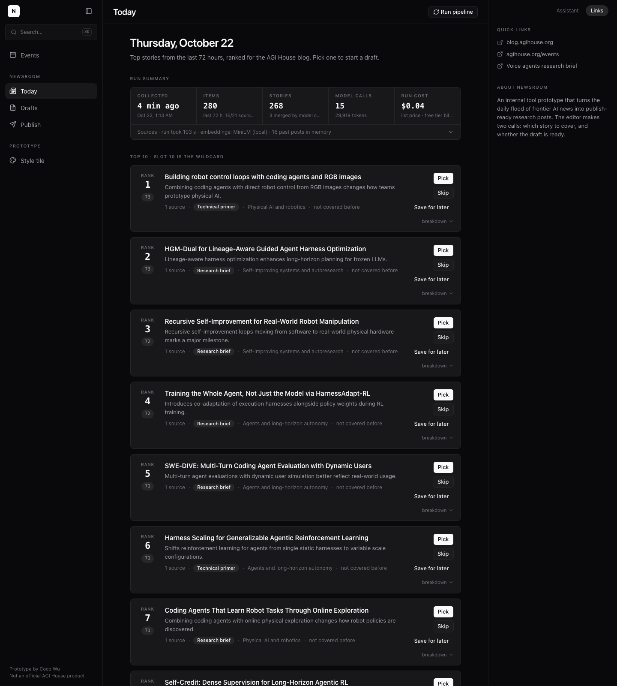
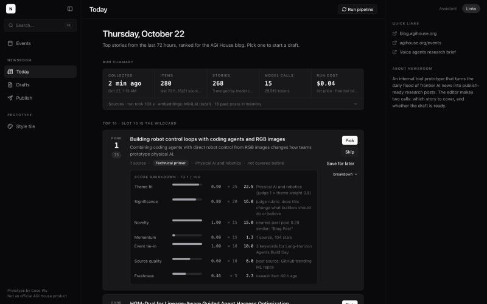
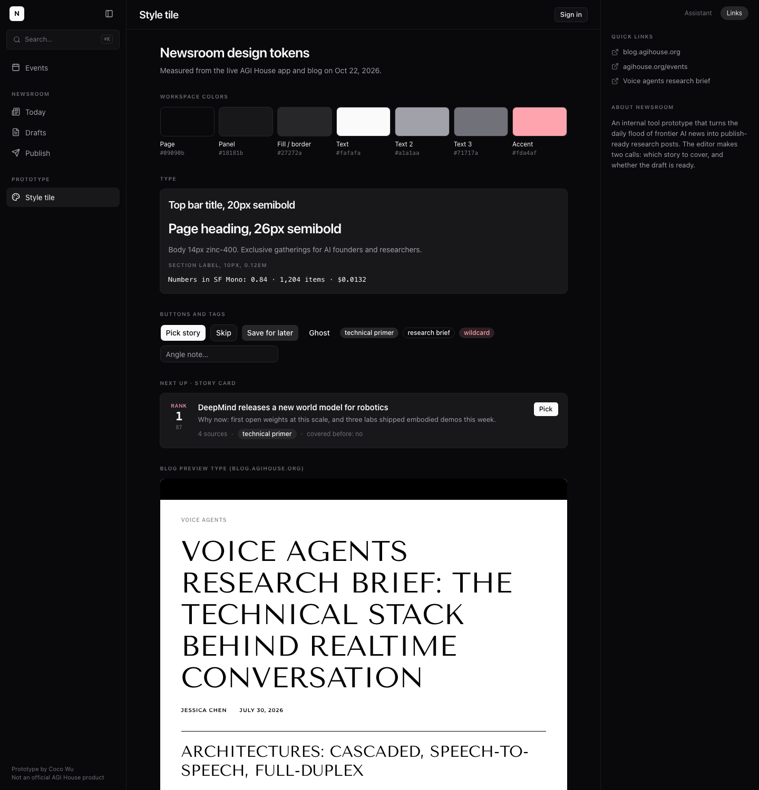
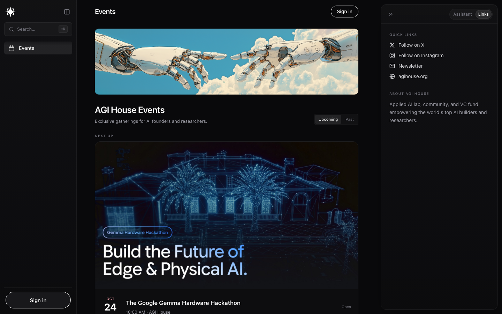
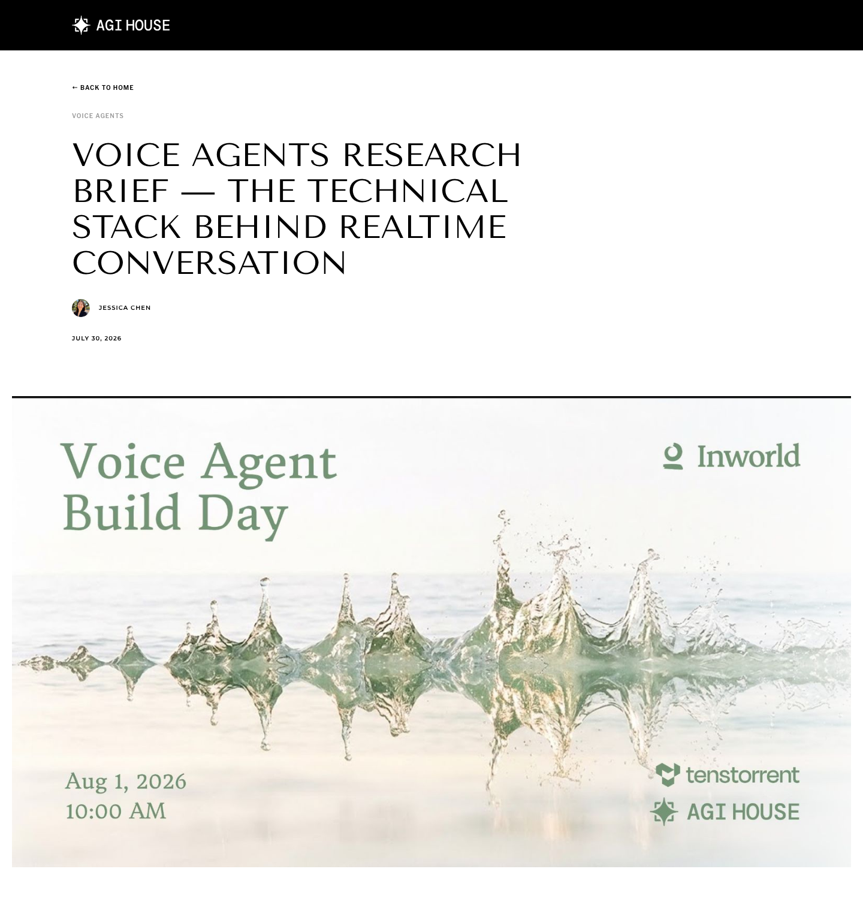

# Morning report: Newsroom

Updated after every milestone so it is accurate even if the build stopped early.
Last update: **after milestone 2** (Today screen on real data).

## Status at a glance

| Milestone | Status |
|---|---|
| 1. Design tokens and style tile, checked against live pages | **Done** |
| 2. Today screen on real data (collect, cluster, rank) | **Done** |
| 3. Draft flow (outline, cited draft, fact-check, images) | Not started |
| 4. Publish screen, demo mode, README | Not started |
| 5. Final pass and demo script | Not started |

## What works

- `npm run build` exits 0. The app shell runs at `http://localhost:3100` with the three-pane layout
  (sidebar with search and an Events link, center column, right panel with Assistant / Links tabs).
- `/style-tile`: colors, type, buttons, tags, a story card and a blog heading block.
- `npm run check:keys`: the Gemini key passes for both text roles.
- **`npm run pipeline`** (also the "Run pipeline" button): collects from 21 configured sources
  (16 working), stores summary + link per item, embeds locally with MiniLM, clusters, ranks on
  seven signals with a batched Gemini judge, refreshes the blog coverage memory (16 past posts)
  and writes a house-style guide. Last live run: 280 items → 268 stories, 15 model calls,
  $0.035 at list price, 103 seconds. Safe to rerun: items dedupe by URL.
- **`/today`**: run summary (when, items, stories, calls, cost, per-source status), top 10
  cards with why-now line, score with the full seven-signal breakdown, expandable source links,
  suggested format, theme, covered-before flag, wildcard in slot 10. Pick (format + angle note),
  Skip, Save for later, all logged in `editor_actions`.

## What is mocked or unavailable

- **AI hero image**: the key is on Google's free tier, where no image model is available. The
  fourth image card will show an "enable billing to turn on" state. The three SVG headers are real.
- **Gemini Pro**: also not on the free tier, so drafting and fact-checking use Gemini 3.8 Flash.
- **Sources without a feed**: Anthropic and xAI publish no RSS (every likely URL is 404/403) and
  VentureBeat returns 429 to non-browser clients. They are listed in the run summary as "no feed".
  Meta is covered through the Meta Engineering feed; Google through the AI blog, Google Research
  and DeepMind feeds.
- **Judge coverage**: on the free tier the judge scores the top 96 stories by a cheap heuristic
  pre-rank (12 calls of 8); the long tail keeps heuristic theme/significance values. Raise
  `JUDGE_MAX_CALLS` to judge more.

## Screenshots (docs/screenshots)

| Today (real run) | Score breakdown expanded |
|---|---|
|  |  |

| Style tile | Live events page | Live blog post |
|---|---|---|
|  |  |  |

Measured values matched the spec: page #09090b, panels #18181b, fills #27272a, text #fafafa /
#a1a1aa / #71717a, 10px semibold uppercase labels with 1.2px tracking, 8px radii, pill buttons,
SF Mono stack. Blog: Tenor Sans 54/60 uppercase H1 and 30/36 H2, Source Serif Pro 18/30 body,
Libre Franklin and Montserrat 10px uppercase labels, 734px text column, 200px contents nav.

## Decisions to review (details in DECISIONS.md)

- Gemini for everything, free tier; Flash for drafting because Pro is unavailable.
- Next's experimental cache mode turned off so pages can read SQLite on each request.
- Screenshots come from the local Chrome in headless mode (nothing installed).
- Rank window: each run ranks everything published in the last 72 h (not only items new since
  the previous run), so a rerun the same day still produces a full digest.
- Significance rubric discounts a lone arXiv preprint with no pickup; event tie-in needs two
  keyword hits for full credit. Both are one-line edits in `lib/pipeline/rank.ts`.

## Open questions

- The top 10 leans toward arXiv papers on agents and self-improvement because theme fit and
  significance carry 45 of 100 points and the judge likes them. If you prefer more lab and
  press news in the digest, lower `theme_fit` or raise `momentum` in `config/ranking.ts`.

## How to run the demo

Coming with milestone 4 (demo mode). For now: `npm run dev -- --port 3100` and open `/style-tile`.

## What failed

- The live events page screenshot needed a longer timeout (the site runs timers).
- First pipeline run never exited: a slow feed left a socket open. The CLI now exits explicitly.
- Google's AI blog feed fails through rss-parser's URL fetch but parses fine from fetched text,
  so the RSS adapter fetches the text itself.
