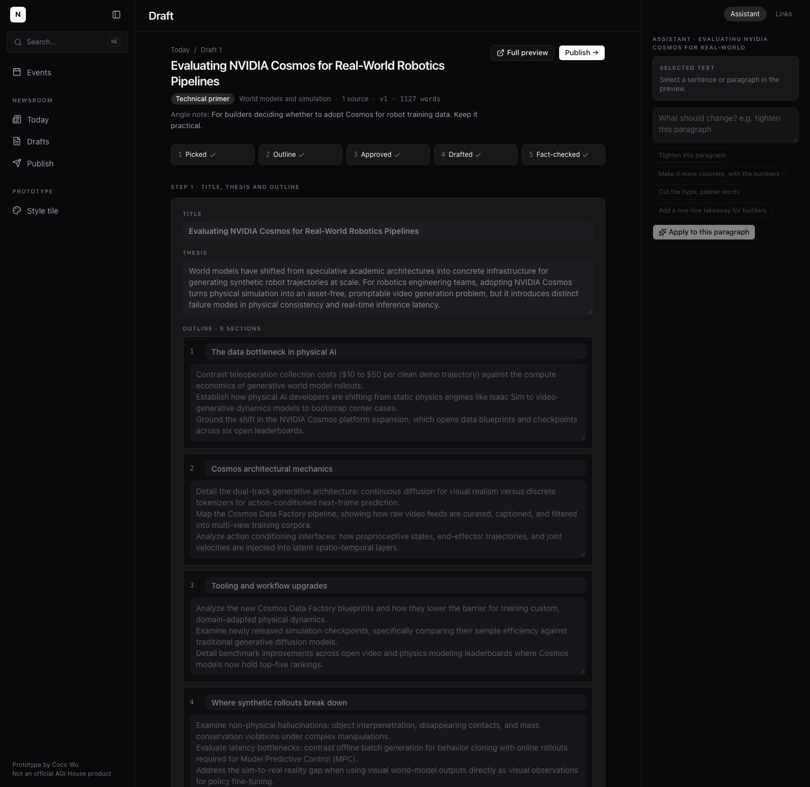
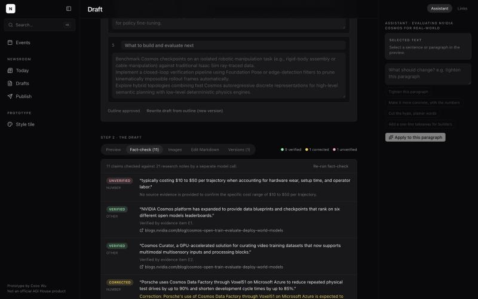
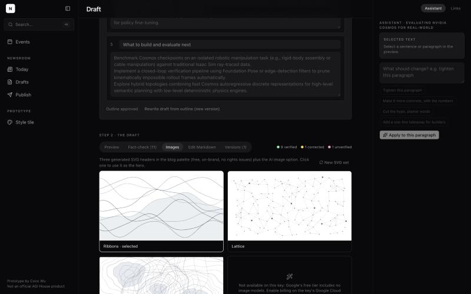
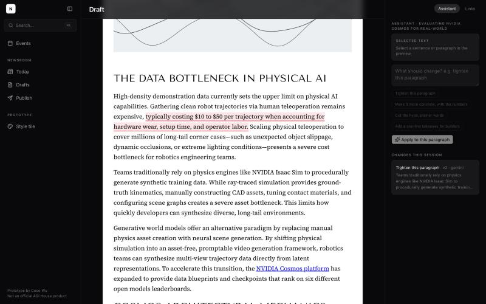

# Morning report: Newsroom

Updated after every milestone so it is accurate even if the build stopped early.
Last update: **after milestone 4** (publish screen, demo mode, README).

## Status at a glance

| Milestone | Status |
|---|---|
| 1. Design tokens and style tile, checked against live pages | **Done** |
| 2. Today screen on real data (collect, cluster, rank) | **Done** |
| 3. Draft flow (outline, cited draft, fact-check, images) | **Done** |
| 4. Publish screen, demo mode, README | **Done** |
| 5. Final pass and demo script | Not started |

## What works

- `npm run build` exits 0. The app shell runs at `http://localhost:3100` with the three-pane layout
  (sidebar with search and an Events link, center column, right panel with Assistant / Links tabs).
- `/style-tile`: colors, type, buttons, tags, a story card and a blog heading block.
- `npm run check:keys`: the Gemini key passes for both text roles.
- **`npm run pipeline`** (also the "Run pipeline" button): collects from 21 configured sources
  (16 working), stores summary + link per item, embeds locally with MiniLM, clusters, ranks on
  seven signals with a batched Gemini judge, refreshes the blog coverage memory (16 past posts)
  and writes a house-style guide. Last live run: 280 items → 268 stories, 15 model calls,
  $0.035 at list price, 103 seconds. Safe to rerun: items dedupe by URL.
- **`/today`**: run summary (when, items, stories, calls, cost, per-source status), top 10
  cards with why-now line, score with the full seven-signal breakdown, expandable source links,
  suggested format, theme, covered-before flag, wildcard in slot 10. Pick (format + angle note),
  Skip, Save for later, all logged in `editor_actions`.
- **`/draft/[id]`**, tested end to end on the NVIDIA Cosmos story:
  - Step 1: proposed title, thesis and 5-section outline (Gemini). Editable; approving it runs
    research → write → fact-check with a visible progress list.
  - Research fetched the sources and saved 21 claims with URLs and excerpts. The draft came back
    at 1,127 words with inline links, rendered in the blog-style preview (Tenor Sans, Source
    Serif, contents sidebar on the full-page `/preview/[id]`).
  - Fact-check by a separate call: 11 claims, 9 verified, 1 corrected, 1 unverified. Corrected
    and unverified claims are highlighted in the preview and listed with sources.
  - Images: three generated SVG headers (ribbons, lattice, contours) in the theme's accent, plus
    the AI image card. Selecting one changes the hero everywhere.
  - Revision: selected a paragraph in the preview, clicked "Tighten this paragraph" in the
    Assistant panel; only that paragraph changed and v2 was saved. Versions tab restores any
    version; Edit Markdown saves manual edits as new versions.
- **`/publish/[id]`**: Markdown (with front matter) and standalone HTML downloads; "Send to blog as
  draft" is a mock that logs the action and shows the exact Webflow CMS API v2 request (draft
  item, field data, image slot) with the follow-ups a real integration needs; newsletter blurb,
  X post and LinkedIn note generated from the final text, editable, with copy buttons.
- **Demo mode**: `npm run demo:load` restores `data/demo-snapshot.json` (one real day: the run,
  280 items, 268 stories, the finished draft with versions, fact-check and images) with dates
  shifted to today and a "Demo snapshot" badge; `npm run demo` starts the app with
  `NEWSROOM_MODE=demo`, which makes no network calls: exact recorded responses are replayed, and
  anything unrecorded uses a labeled heuristic. Verified on a scratch database: all pages, revise
  and snippets replayed, AI image card says "demo mode".
- **README.md** with a screenshot per screen, how to run, real-versus-mocked table and roadmap.

## What is mocked or unavailable

- **AI hero image**: the key is on Google's free tier, where no image model is available. The
  fourth image card will show an "enable billing to turn on" state. The three SVG headers are real.
- **Gemini Pro**: also not on the free tier, so drafting and fact-checking use Gemini 3.8 Flash.
- **Sources without a feed**: Anthropic and xAI publish no RSS (every likely URL is 404/403) and
  VentureBeat returns 429 to non-browser clients. They are listed in the run summary as "no feed".
  Meta is covered through the Meta Engineering feed; Google through the AI blog, Google Research
  and DeepMind feeds.
- **Gemini 3.8 Flash quota**: during the build its free-tier quota ran out (429) and it also
  returned 503 "high demand" for minutes at a time. The model chain then uses Gemini 3.6 Flash,
  then 2.5 Flash, then Flash-Lite; the step detail says which model answered. Expect the same on
  demo day: it is handled, but drafts from the smaller models are shorter.
- **Judge coverage**: on the free tier the judge scores the top 96 stories by a cheap heuristic
  pre-rank (12 calls of 8); the long tail keeps heuristic theme/significance values. Raise
  `JUDGE_MAX_CALLS` to judge more.

## Screenshots (docs/screenshots)

| Today (real run) | Score breakdown expanded |
|---|---|
|  |  |

| Draft: outline step | Blog preview with highlighted claim | Fact-check panel |
|---|---|---|
|  |  |  |

| Image options | Assistant revision (v2) | Publish |
|---|---|---|
|  |  |  |

| Style tile | Live events page | Live blog post |
|---|---|---|
|  |  |  |

Measured values matched the spec: page #09090b, panels #18181b, fills #27272a, text #fafafa /
#a1a1aa / #71717a, 10px semibold uppercase labels with 1.2px tracking, 8px radii, pill buttons,
SF Mono stack. Blog: Tenor Sans 54/60 uppercase H1 and 30/36 H2, Source Serif Pro 18/30 body,
Libre Franklin and Montserrat 10px uppercase labels, 734px text column, 200px contents nav.

## Decisions to review (details in DECISIONS.md)

- Gemini for everything, free tier; Flash for drafting because Pro is unavailable.
- Next's experimental cache mode turned off so pages can read SQLite on each request.
- Screenshots come from the local Chrome in headless mode (nothing installed).
- Rank window: each run ranks everything published in the last 72 h (not only items new since
  the previous run), so a rerun the same day still produces a full digest.
- Significance rubric discounts a lone arXiv preprint with no pickup; event tie-in needs two
  keyword hits for full credit. Both are one-line edits in `lib/pipeline/rank.ts`.

## Open questions

- The top 10 leans toward arXiv papers on agents and self-improvement because theme fit and
  significance carry 45 of 100 points and the judge likes them. If you prefer more lab and
  press news in the digest, lower `theme_fit` or raise `momentum` in `config/ranking.ts`.

## How to run the demo

Safest path (no network, no key needed):

```bash
npm install
npm run demo:load      # restores the saved real day; dates read as "today"
npm run demo           # http://localhost:3100 in demo mode (recorded model responses)
```

Live path (free-tier Gemini key in .env.local): `npm run pipeline` (about 2 minutes), then
`npm run dev -- --port 3100`. The draft flow then makes real model calls; expect 20 to 60 seconds
per step and the occasional fallback to a smaller Flash model (shown in the step detail).

The step-by-step demo script arrives with milestone 5.

## What failed

- A batch of database writes was lost once during a dev-server restart (DECISIONS.md #20). The
  db client now checkpoints every 4 s and closes cleanly; `scripts/dev-restart.sh` waits for the
  file to be free. The demo snapshot is the safety net.

- The live events page screenshot needed a longer timeout (the site runs timers).
- First pipeline run never exited: a slow feed left a socket open. The CLI now exits explicitly.
- Google's AI blog feed fails through rss-parser's URL fetch but parses fine from fetched text,
  so the RSS adapter fetches the text itself.
