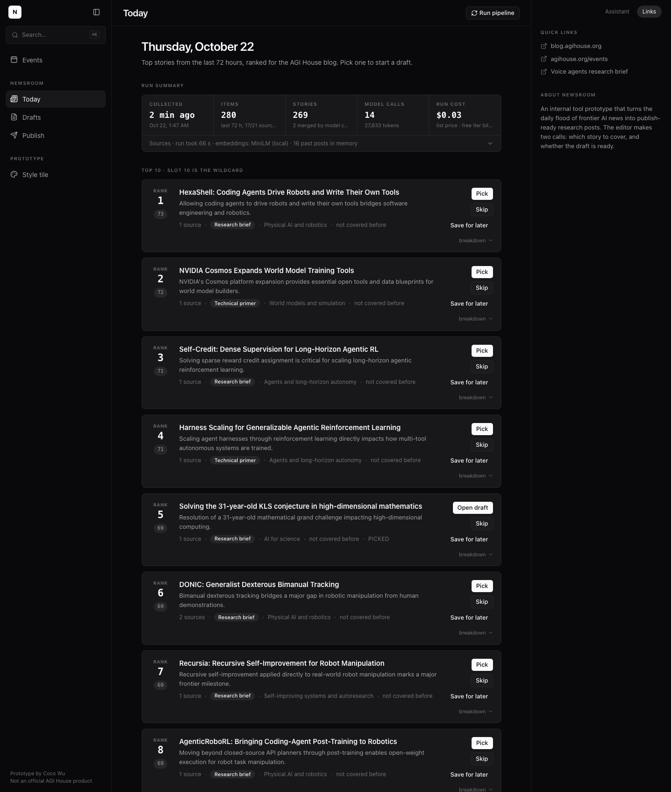
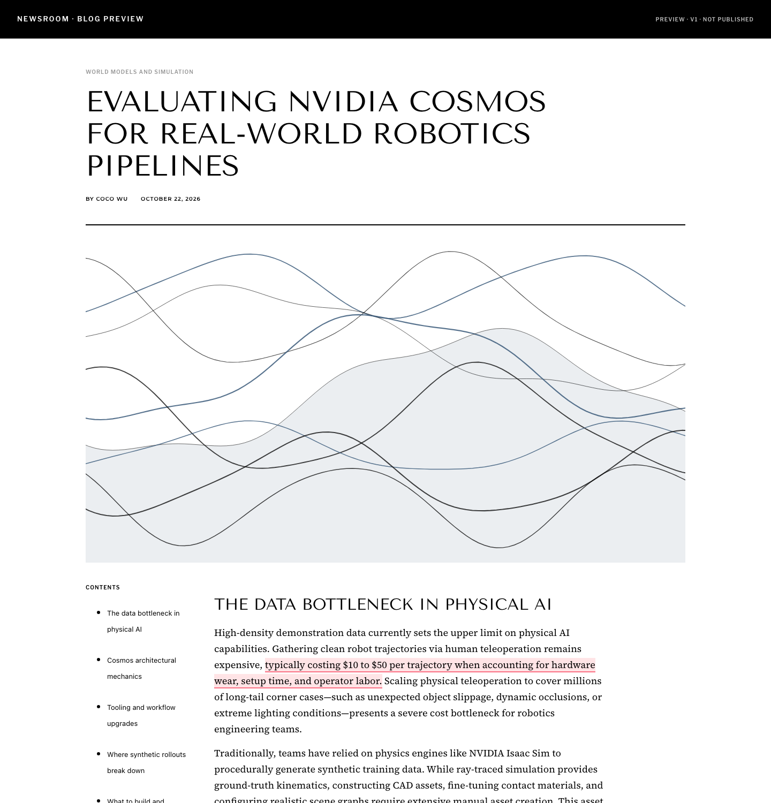
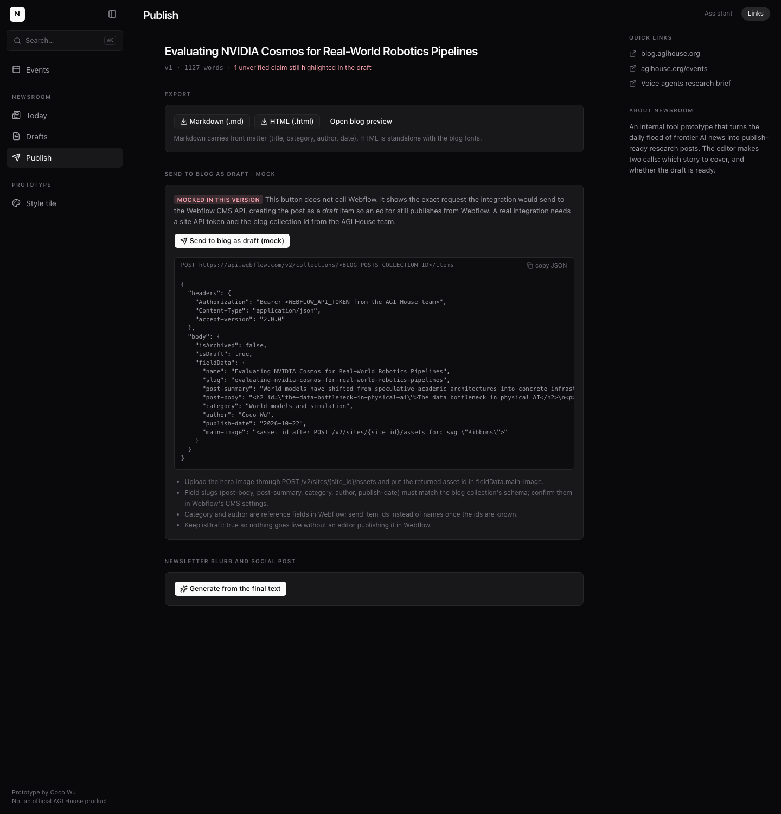
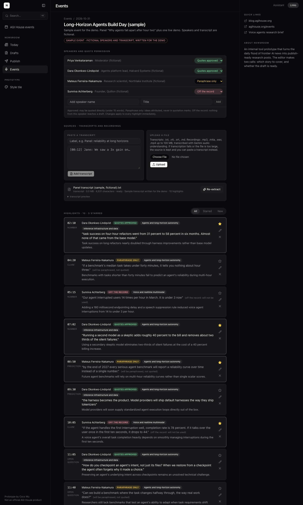

# Newsroom

**Prototype by Coco Wu.** Not an official AGI House product.

Newsroom turns the daily flood of frontier AI news into publish-ready research posts for a blog
like [blog.agihouse.org](https://blog.agihouse.org). A pipeline collects, clusters and ranks the
day's stories; a human editor makes two calls, **which story to cover** and **whether the draft is
ready**; the app drafts, fact-checks, illustrates and exports the post.

| Today: ranked digest | Draft: outline → cited draft → fact-check | Publish: exports, mock Webflow send, snippets | Events: transcripts → highlights |
|---|---|---|---|
|  |  |  |  |

## What it does

1. **Collect.** 21 configured sources (frontier lab blogs, arXiv cs.AI/LG/CL/CV/RO, Hugging Face
   daily papers, trending GitHub repos, Hacker News, tech press), normalized to one schema,
   summary and link only. One failing source never fails the run.
2. **Cluster.** Local sentence embeddings (MiniLM through transformers.js, no API key) merge items
   about the same event; borderline pairs are checked by a small model. Every story keeps all its
   sources and names a primary one.
3. **Rank.** Seven signals, each 0 to 1, weighted to a 0 to 100 score: theme fit 25, significance
   20 (both from a model judge with a written rubric against the editorial profile), novelty 15
   (distance from past posts), momentum 15, event tie-in 10, source quality 10, freshness 5. Every
   value is stored and shown in the card's breakdown.
4. **Coverage memory.** Recent posts from the blog give the novelty signal, the "covered before"
   flag and a generated house-style guide.
5. **Draft.** The editor approves a proposed title, thesis and outline. Research runs per section
   in parallel, saving each claim with its source URL. The draft is written in house style with
   inline links, rendered in a blog-style preview (Tenor Sans, Source Serif, contents sidebar).
6. **Fact-check.** A separate model call that did not write the draft marks every claim verified,
   corrected or unverified, with its source. Unverified claims are highlighted in the preview.
7. **Images.** Three abstract SVG headers generated from the story's theme in the blog palette,
   plus an AI image card wired to the Gemini image model.
8. **Revise.** Select text in the preview and ask the Assistant panel for a change. Only that
   paragraph is rewritten; every change is a new version, and old versions can be restored.
9. **Publish.** Markdown and HTML export, the exact Webflow CMS payload that a real integration
   would send (mocked), and a newsletter blurb plus social posts from the final text.

10. **Event capture** (branch `event-capture`). Much of what AGI House publishes starts at its
    in-person events, so talks, panels and demos can feed posts too. Create an event with its
    speakers, add sources by pasting text, uploading .txt/.vtt/.srt/.md transcripts, or uploading
    mp3/m4a/wav/mp4 recordings (transcribed with Gemini audio understanding; if that fails or the
    file is too large, the UI says so and asks for a transcript). Each source yields 8 to 15
    highlight cards with speaker, timestamp, type (claim, number, prediction, demo, open
    question), a quote under 25 words, a paraphrase and theme tags. The editor stars, edits or
    rejects them. **Consent is enforced:** every speaker has a quote permission (approved,
    paraphrase only, off the record; default paraphrase only), shown on every card; drafts never
    quote an unapproved speaker and never use an off-the-record one. Starred highlights attach to
    an existing draft as cited evidence (the fact-check treats the transcript timestamp as the
    source) or start an event-recap draft through the normal outline approval. Starred highlights
    also boost matching Today stories' theme fit and event tie-in, with the reason in the breakdown.
    Demo mode ships one sample event with a fictional transcript, clearly labeled.

Every editor action is logged, every model call is logged with tokens and list-price cost, and
the Today screen shows the cost of the run.

## Run it

```bash
npm install
cp .env.example .env.local            # paste a Gemini API key (free tier is enough for text)
npm run check:keys                    # one tiny call per model role
npm run pipeline                      # live daily run: collect → cluster → rank (about 2 minutes)
npm run dev -- --port 3100            # open http://localhost:3100
```

Demo mode, no network and no key needed:

```bash
npm run demo:load                     # load the saved snapshot of one real day (includes the sample event)
npm run demo                          # dev server with NEWSROOM_MODE=demo (recorded model responses)
```

`npm run build` must exit 0; `scripts/dev-restart.sh` restarts the dev server safely.

## Real versus mocked

| Piece | Status |
|---|---|
| Collection from feeds and APIs | Real (16 of 21 sources have usable feeds; Anthropic, xAI have no RSS, VentureBeat blocks bots) |
| Embeddings and clustering | Real, local (MiniLM; TF-IDF fallback if the model cannot load) |
| Ranking judge, outline, research, draft, fact-check, revision, snippets | Real Gemini calls (Flash-Lite for triage, 3.8 Flash for drafting; the key is free tier so Pro is unavailable) |
| Replay cache | Real: every response is recorded; demo mode replays them, and any failed call falls back to the cache, then to a heuristic |
| SVG header images | Real, generated locally |
| Event transcription (audio/video) | Real Gemini audio-understanding call, with a clear failure message asking for a transcript; demo mode skips it |
| Event highlights, consent, attach, recap, boosts | Real; the sample event's transcript and speakers are fictional and labeled |
| AI header image | Wired to Gemini's image model, but **not available on a free-tier key**; the card says so and shows the price it would cost |
| Send to blog (Webflow) | **Mock**: the exact payload is shown, nothing is sent; needs a site token and collection id |
| Cost per run | List prices from Google's pricing page; free-tier calls bill $0 |

## Stack

Next.js 16 (App Router), TypeScript, Tailwind CSS 4, shadcn/ui, SQLite (better-sqlite3 + Drizzle),
`@google/genai`, `@huggingface/transformers`, `rss-parser`, `marked`. Design tokens were measured
from the live AGI House app and blog (see `app/globals.css` and `docs/screenshots/m1-*`).

See `PLAN.md` for the architecture, `DECISIONS.md` for every judgment call, and
`MORNING_REPORT.md` for status, the demo script and what failed.

## Roadmap

- A scheduled daily run (cron or a hosted job) with a Slack digest each morning.
- Real Webflow publishing once the AGI House team provides a token and the collection schema.
- Ranking weights that learn from the editor's picks, skips and saves (`editor_actions` already has the data).
- HTML adapters for the labs without feeds, and image generation once billing is enabled.
